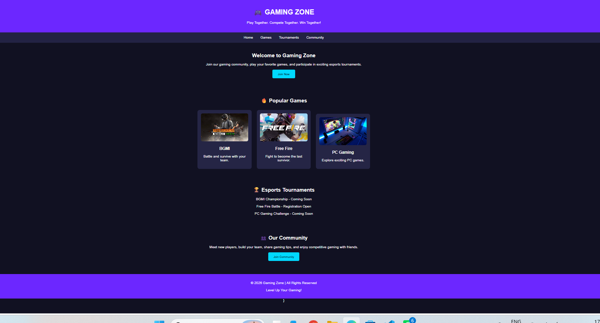
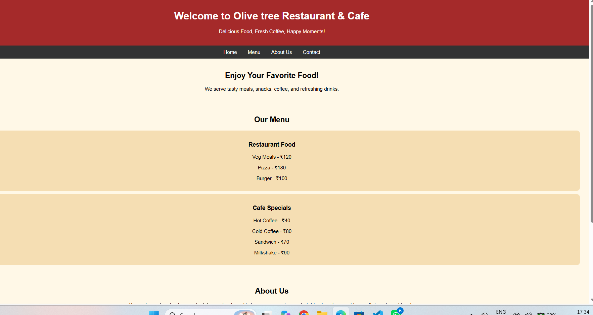
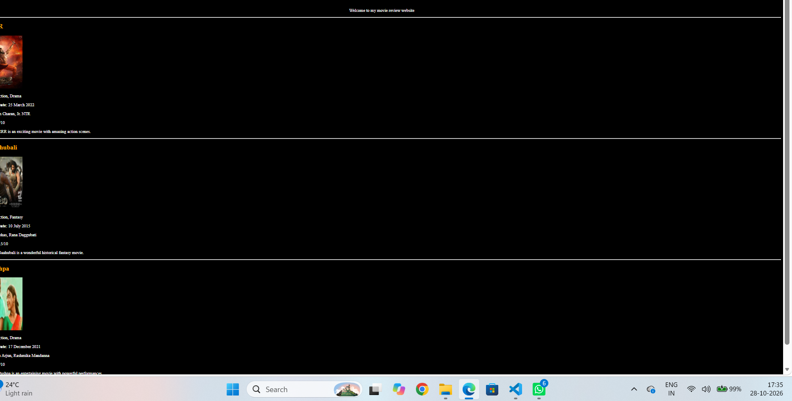

# WEB DEVELOPMENT LAB

**Student Name:** T. Navadeep  
**Branch:** CSE (AI & ML)  
**Year:** First Year B.Tech  
**Section:** 06  
**Subject:** Web Development  
**Academic Year:** 2026–2030

---

## Case Study 1: Game Zone Website

**Description:** A simple gaming website featuring games and gaming-related information.

**Source Code:** [View index.html](index.html)

### Output Screenshot

---

## Case Study 2: Restaurant and Cafe Website

**Description:** A website showcasing restaurant and cafe details, food items, and menu information.

**Source Code:** [View index2.html](index2.html)

### Output Screenshot

---

## Case Study 3: Movie Review and Rating Website

**Description:** A website displaying movie posters, genres, release dates, cast details, reviews, and ratings.

**Source Code:** [View index3.html](index3.html)

### Output Screenshot

---

